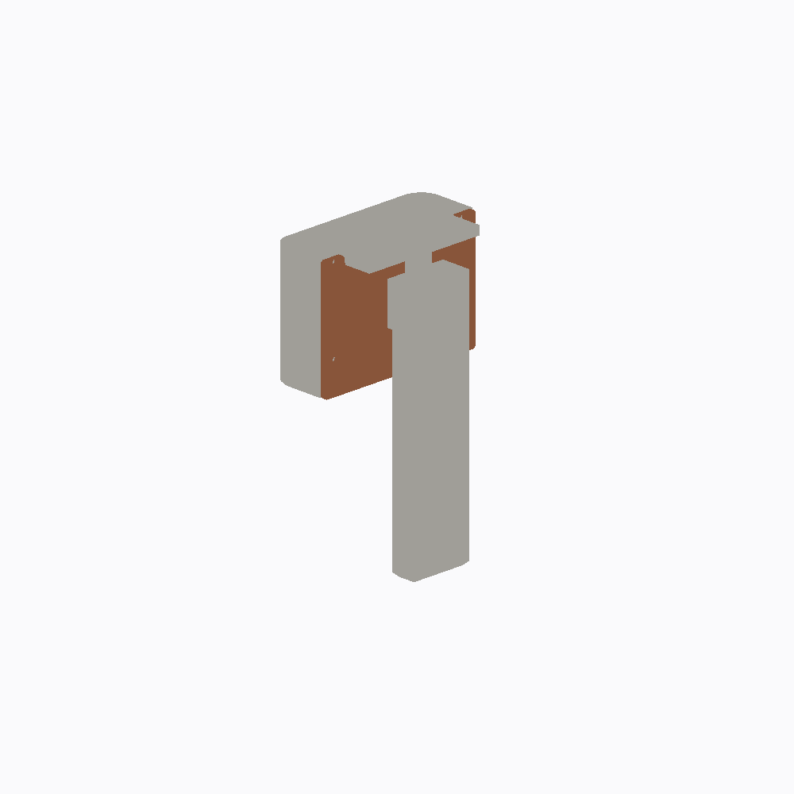
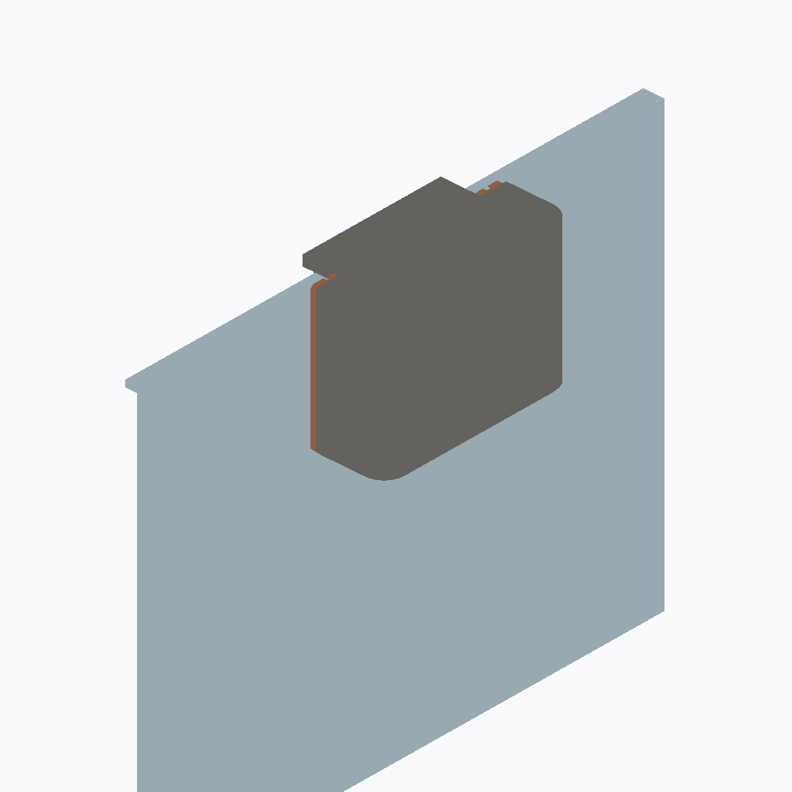
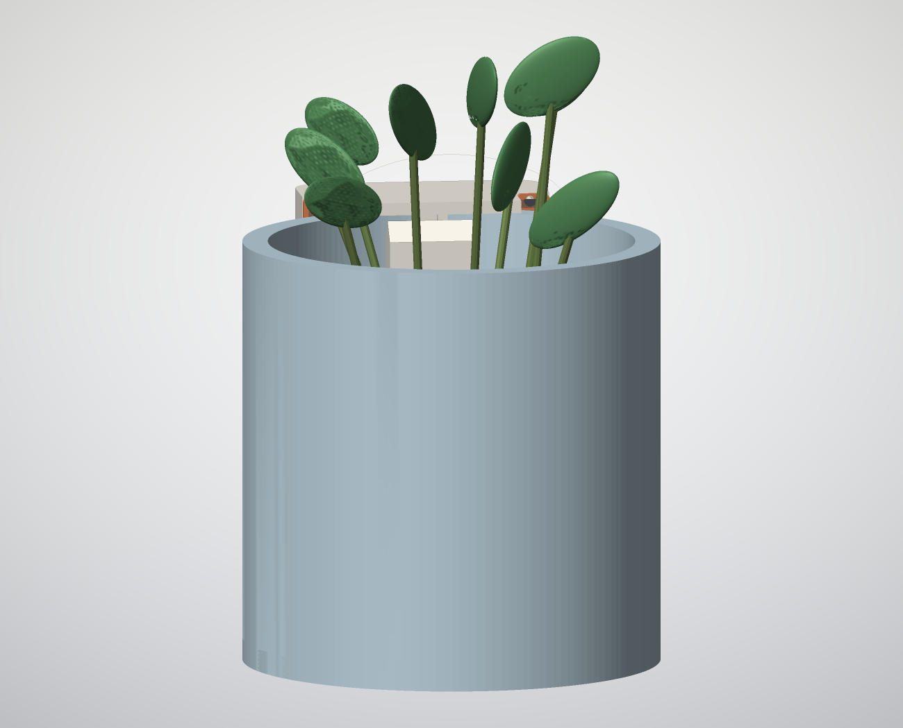
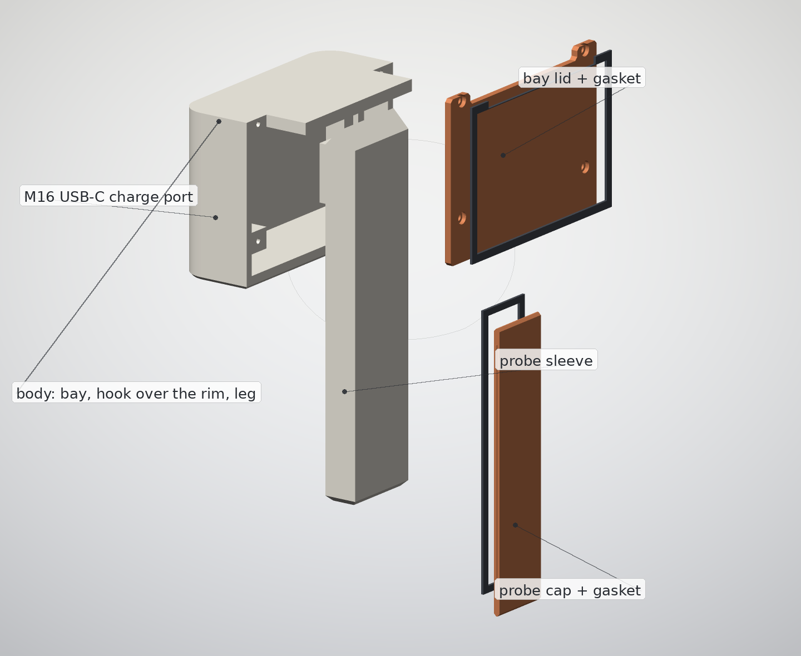
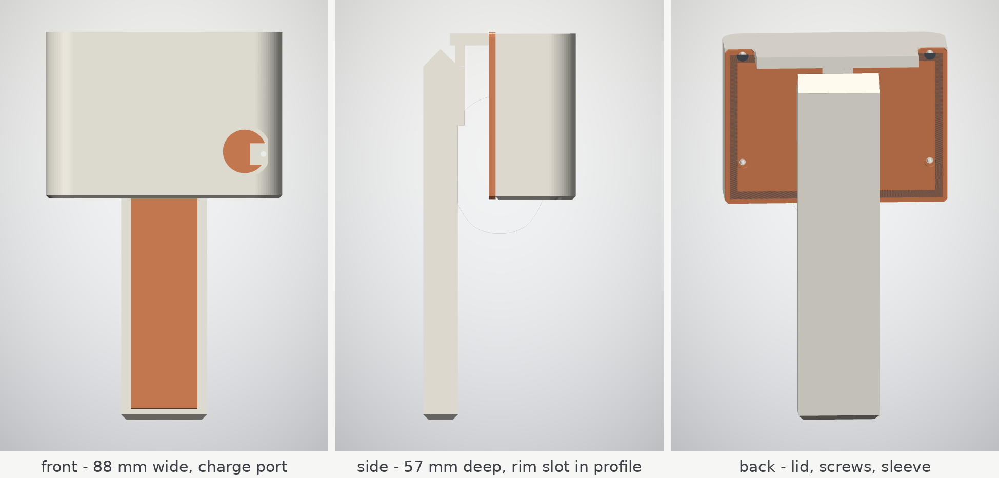
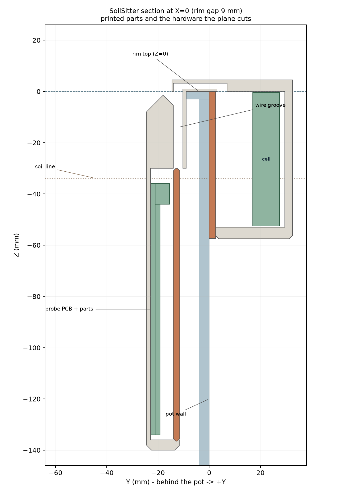

# SoilSitter

A battery-powered soil-moisture sensor that **hangs over the rim of a plant pot and
hides behind it**. No cable across the windowsill, no dongle standing in the soil,
no hub in the middle of the plant — the electronics bay sits on the outside of the
pot, the probe slides down the inside wall, and the whole thing disappears when you
look at the plant from the room.



ESPHome firmware, 3D-printable case, months on a charge, and it drops straight
into the [SharedLLM](../SharedLLM) **Home Hub / Garden** stack, where it shows up as
a plant that needs water.

| | |
|---|---|
| **MCU** | ESP32-C3 SuperMini (USB-C, Wi-Fi, deep sleep) |
| **Sensor** | Capacitive Soil Moisture Sensor V1.2 (corrosion-resistant, analogue) |
| **Power** | 103450 LiPo 2000 mAh + TP4056 Type-C charge board |
| **Run time** | ~5 months at a 30 min wake interval, estimated (see [docs/USAGE.md](docs/USAGE.md)) |
| **Case** | 3 parts + 2 gaskets, ~50 g of filament, **no supports**; pre-oriented in `stl/print/` |
| **Integration** | ESPHome native API → Home Hub, `device_class: moisture` → Garden |
| **Pot fit** | 9 mm rim by default; 6 mm and 12 mm variants included |

## How it hangs

```
        room                                 pot
   ┌──────────────┐                  ┌─────────────────┐
   │  bay (MCU,   │                  │                 │
   │  battery,    │◄── bridge over ──┤   rim           │
   │  charger)    │    the rim       │                 │
   └──────────────┘                  │  ║ leg against  │
                                     │  ║ inner wall   │
                                     │  ║              │
                                     │  ║ probe sleeve │
                                     │  ║ in the soil  │
                                     └─────────────────┘
```

The bay hangs on the **outside** of the pot at `Y > 0`, the probe sleeve sits at
`Y < -14` inside the pot, and a 5 × 2.2 mm groove up the leg carries the three
probe wires over the rim and into the bay. Nothing is glued, screwed or clamped to
the pot: the hook is a close sliding fit on the rim, and the weight of the bay
counterbalances the probe.

## What it looks like

| Assembled | Hung on a pot |
|---|---|
|  |  |
| **From the room** — the bay's top plate is the only thing that shows over the rim | **From the pot side** — the hook over the rim, the leg down the inside wall, the sleeve in the soil |

| From the room, at eye level | Exploded |
|---|---|
|  |  |
| Nothing but the pot and the plant: the bay, the charge port and the wires are all on the far side | Body (bay, hook, leg, sleeve), bay lid + gasket, probe cap + gasket |





*Rendered from the exported STLs by `cad/preview.py` and `cad/render.py`, with the
real hardware boxes from `cad/check_fit.py`; no photographs, no manual retouching.*

## Repo layout

```
cad/            parametric build123d model, fit checks, renderers
  soilsitter.py   the case (--rim-gap 6 | 9 | 12)
  check_fit.py    watertightness, packing, clearance, wire-route checks
  orient.py       picks each part’s print orientation, writes stl/print/
  preview.py      photoreal previews: hero, exploded, mounted, room, views, plate
  render.py       the X=0 cutaway drawing
stl/            STLs in assembly orientation + manifest_rim<N>.json
  print/          the same parts pre-rotated for printing + manifest.json
firmware/       soilsitter.yaml, secrets.yaml.example
docs/           BOM, wiring, assembly, calibration, usage, integration
tools/          build.sh, validate.sh
```

## Quick start

```bash
# 1. Print (rim 9 mm is the default; see docs/ASSEMBLY.md for settings)
make stl print-stl            # geometry, then print-ready orientations
# stl/ = assembly orientation; stl/print/ = the files you actually slice

# 2. Wire it (docs/WIRING.md) and calibrate the probe (docs/CALIBRATION.md)

# 3. Flash
cd firmware
cp secrets.yaml.example secrets.yaml      # Wi-Fi, AP password, API key
esphome run soilsitter.yaml

# 4. Adopt it in Home Hub (docs/INTEGRATION.md) — it stays awake until adopted
```

## The parts

| File | What it is |
|---|---|
| `stl/body_rim<N>.stl` | bay + over-rim hook + inner leg + probe sleeve, one piece |
| `stl/bay_lid_rim<N>.stl` | closes the bay, 4 × M2.5 screws, bottom lip hooks under the body |
| `stl/probe_cap_rim<N>.stl` | seals the probe sleeve, trapped top and bottom by the sleeve's lips |
| `stl/bay_gasket_rim<N>.stl` | 1 mm silicone gasket for the lid |
| `stl/probe_gasket_rim<N>.stl` | 1 mm silicone gasket for the probe cap |

Print the gaskets in TPU if you have it, or cut them from a 1 mm silicone sheet
using the STL as a template. They are optional indoors, essential if the pot lives
somewhere humid or outdoors.

## Fitting your pot

`--rim-gap` is the rim thickness the hook is cut for. Measure the rim (or the wall
at the top) with calipers and pick the closest of **6, 9 or 12 mm**; the hook is a
1 mm-per-side clearance fit, so a 10 mm rim uses the 12 mm hook happily. Only the
12 mm variant needs support under the hook bridge; the 6 and 9 mm hooks bridge on
their own. Rebuild for anything else:

```bash
python cad/soilsitter.py --rim-gap 10          # -> *_rim10.stl, any value works
```

The model is parametric, so `BAY_*`, `PROBE_*` and `RIM_GAP` in
[cad/soilsitter.py](cad/soilsitter.py) can be edited for bigger batteries, other
probe boards or thicker rims.

## Documentation

- **[docs/BOM.md](docs/BOM.md)** — everything to buy, with Amazon links
- **[docs/WIRING.md](docs/WIRING.md)** — pin map, soldering, wire lengths
- **[docs/ASSEMBLY.md](docs/ASSEMBLY.md)** — print settings and step-by-step build
- **[docs/FIT.md](docs/FIT.md)** — measured sizes of every part, and the clearance the case gives it
- **[docs/CALIBRATION.md](docs/CALIBRATION.md)** — dry/wet calibration and the battery curve
- **[docs/USAGE.md](docs/USAGE.md)** — placement, charging, battery-life maths, quirks
- **[docs/INTEGRATION.md](docs/INTEGRATION.md)** — Home Hub adoption and the Garden binding

## Status

Firmware is compiled and validated with ESPHome 2026.9 (`esphome config` +
`esphome compile`); the case passes the automated fit checks in
[cad/check_fit.py](cad/check_fit.py) — watertightness, bay packing, screw
keep-outs, probe cavity, the sampled wire route, the rim slot, lid notch, cap
coverage and overhang area — for all three rim sizes. `tools/validate.sh` runs
the whole lot. Both have been designed against datasheet dimensions, not against a
physical build: expect one round of tolerance tweaks on your first print, mostly
around the USB-C pigtail and the probe cap.

## Credits

A functional remix of Thingiverse thing **6908755** (*"Plant Pot Self Watering
Sensor Holder"*, SMD sensor box hanging over the rim). The original is a holder;
this is a complete battery-powered device: new geometry (bay, lid, probe sleeve,
cap, gaskets, wire route), new firmware, and the Home Hub integration.

## Licence

MIT — see [LICENSE](LICENSE).
