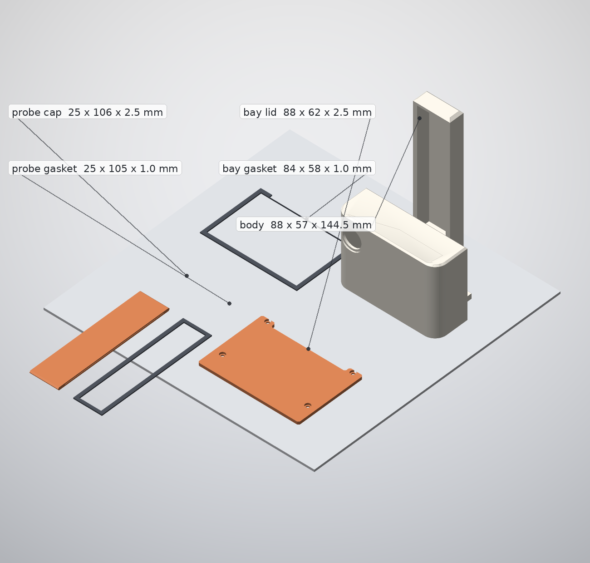
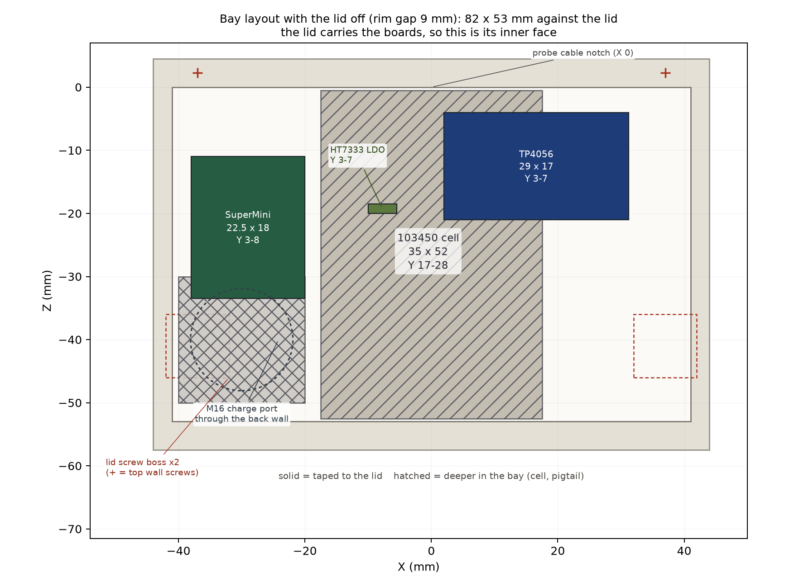

# Assembly

Five printed parts — three structural, two gaskets — and four screws. About 45
minutes of assembly once the print is off the bed, most of it waiting for silicone
to cure.

## Print settings

| | |
|---|---|
| Material | PETG or ASA outdoors; PLA is fine indoors but creeps under the bay's screw load in a hot window |
| Layer | 0.20 mm (0.28 mm is acceptable, 0.16 mm for the lid's sealing face) |
| Walls | 3 perimeters, 4 on the body |
| Infill | 15 % gyroid |
| Orientation | **Use `stl/print/`**, not `stl/` — those files are pre-rotated. Body: bay down, sleeve up (88 × 57 × 144.5 mm on the bed) |
| Supports | **None.** All five parts are self-supporting; `check_fit` asserts 0 mm² of free overhang |
| Brim | 8 mm, body only |
| Bed | A 235 × 235 mm plate takes all five parts at once |

**Why bay-down.** Printed the way the STL is modelled (sleeve down, bay up) the bay's
floor is an 88 × 30 mm plate that starts in mid-air: a support job, and a 140 mm
tower standing on a 32 × 13 mm foot. Turned over, the bay's rim face is on the bed
(3685 mm² of contact, the heavy end low) and the sleeve rises from a wide base.
`cad/orient.py` scores all 24 axis-aligned orientations and exports that one. It
reports **0 mm² of free overhang** and ~2800 mm² of *bridged* area — interior
ceilings over the bay and the probe cavity, which no support can reach and none is
needed for: they are shelves carried on three walls, not floating plates. The
numbers live in `stl/print/manifest_rim<N>.json`, and `cad/check_fit.py` fails the
build if a geometry change puts a free overhang back.

Getting to zero took one geometry change: the probe sleeve used to end in a flat
25 x 6 mm top face, which hangs in mid-air when the body is printed bay-down. It is
now roofed at 45° (a 6.5 mm ridge, `PROBE_TOP` in `cad/soilsitter.py`). That ridge
sits inside the pot, below the rim, out of sight — and it stiffens the sleeve/leg
joint, which was the other weak spot.

**Known print risk.** It is still a 144.5 mm print with a 110 mm long, 32 × 13 mm
sleeve standing up. It is stable because the mass is at the bottom, but use the brim
and slow the first 40 mm on a bed-slinger. The height is set by the 98 mm probe PCB,
so it cannot be shortened for this sensor.

Expect **~50 g** of filament for the body and **~8 h** on a 0.4 mm nozzle at
0.20 mm layers. The lid and cap are 25 minutes each.

| Part | Print notes |
|---|---|
| `body` | Bay down, sleeve up (already rotated in `stl/print/`). The 45° roof over the sleeve is the reason it needs no support. Brim, and slow the first 40 mm. Check that the wire groove up the leg is clear with a 5 mm hex key before you assemble |
| `body_rim12` | Same settings; the 14.5 mm hook bridge is at the bottom edge in this orientation and also needs nothing |
| `bay_lid` | Print flat, outside face down. The bottom lip is a 1 mm feature — if your first layer squashes badly, the lip will not hook under the body; print it at 0.16 mm |
| `probe_cap` | Flat, gasket groove up |
| `bay_gasket` | TPU at 0.20 mm, or cut from 1 mm silicone sheet using the STL as a template |
| `probe_gasket` | Same. It is 106 mm long and only 1 mm thick: a cold bed will curl it, so print it last and let it cool flat |

## Fasteners

Four M2.5 × 10 mm self-tapping screws, straight into printed Ø2.1 mm pilots:

- two into the bay's top wall (Z ≈ +2 mm),
- two into the bottom corner bosses (Z ≈ −41 mm).

Run each screw in **once, slowly, then back it out** before final assembly. That
cuts the thread and burnishes the hole; doing it with the gasket in place tends to
skew the screw and strip the pilot. If a pilot strips, a drop of CA glue and three
minutes will hold it for another cycle.

## What goes where

Everything but the cell and the pigtail is taped to the **lid's inner face**, so
opening the case lifts the whole electronics stack out in one piece and nothing has
to be unscrewed to get at it. The bay is 27 mm deep, which is why the cell and the
pigtail — hatched in the drawing — sit behind the boards rather than under them.

| Part | Where (X, Z) | Depth (Y) | Notes |
|---|---|---|---|
| SuperMini | X −38…−20, Z −33…−11 | 3–8 | left of the bay, antenna end up, 3.0 mm clear of the wall |
| TP4056 | X 2…31, Z −21…−4 | 3–7 | right of centre; its USB-C faces the pigtail's lead, 0.8 mm clear of the screw boss |
| HT7333 | X −10…−5.5, Z −20…−18.5 | 3–7 | in between the two, 1.5 mm thick, flat to the lid |
| 103450 cell | X −17.5…17.5, Z −52…0 | 17–28 | standing on the floor against the back wall, ~10 mm behind the boards |
| M16 pigtail | X −40…−20, Z −50…−30 | 16–30 | over the port in the back wall, nut inside |
| probe PCB | in the sleeve, Z −134…−36 | — | sensing face against the 1.6 mm front wall |

Those are the same numbers `cad/check_fit.py` verifies, and the same boxes the
drawings are made from, so a part that grows shows up here and in the check at the
same time.

## Step by step

1. **Test the electronics outside the case.** Flash the firmware, confirm Wi-Fi and
   a soil reading on the bench ([CALIBRATION.md](CALIBRATION.md)). Debugging is
   much easier before the probe is down a sleeve.
2. **Clean the body.** Deburr the rim slot, the bay notch and the leg groove. Blow
   out the probe cavity; a stray string of PETG will stop the probe seating.
3. **Dry-fit the probe.** Slide the V1.2 board into the sleeve from the bottom,
   sensing face towards the 1.6 mm front wall. It should go in with light thumb
   pressure and stop against the collar at Z ≈ −30 mm. **Check the connector first:**
   the sleeve leaves 6.6 mm above the PCB before the cap's inner face, so a JST-PH
   socket (5.6 mm) is fine and a straight 2.54 mm header (~8.5 mm) is not — desolder
   it or fit a right-angle one ([FIT.md](FIT.md)). If the board binds, the cavity
   floor has a blob — file it, do not force the board, the electrode is a thin
   copper pour and it will crease. The [X=0 cutaway](diagrams/section.png) shows
   how tight that stack is.
4. **Seat the C3 in the bay.** It goes on the lid, not the body: three 3 mm foam
   tape pads under its two long edges (clear of the USB-C shell), then press it
   onto the lid's inner face, antenna end up (towards the bay's top edge) and away
   from the cell and the metal pigtail. Taped to the
   lid means the whole stack lifts out when you open the case. The 3 mm tape
   thickness is what the fit check assumes, so keep it under 3.5 mm.
5. **Battery.** Foam tape on the *back* of the pouch, then stand it on the bay
   floor against the back wall with its leads out of the top, towards the charge
   board. It is 52 mm tall in a 53 mm bay, so it will touch both ends — that is
   the fit, not a mistake. It sits ~10 mm behind the boards, which is deliberate:
   the TP4056 gets warm while charging and the pouch should not be against it.
6. **Charge board and LDO.** Same 3 mm foam tape. The LDO sits between the C3 and
   the charger (X −10…−5.5); the charger goes to the right of centre, Z −21…−4 —
   **not** at the bottom-left corner, which is a lid screw boss. The pigtail's
   lead crosses the bay to reach the charger's USB-C; plug it in *before* you tape
   the board down (the connector is easier to seat with the board loose) and dress
   the lead flat against the lid so the lid still closes.
7. **Dress the wiring.** The probe bundle goes up the leg groove and into the bay
   through the notch at the top; leave 30 mm of slack inside the bay so the lid
   closes without trapping a wire.
8. **Gaskets and lid.** Gasket flat on the lid's inner face - it sits inside the
   bay's 1 mm rebate, so it should drop in without stretching. Then the lid's lip
   under the body's bottom edge, hinge the lid up, four screws finger-tight then a
   quarter turn. Do not
   overtighten: the gasket only needs to be compressed, and the pilot is plastic.
9. **Probe cap.** Gasket into the cavity mouth (it lines the seat, flush with the
   opening), then the cap over it and the sleeve's bottom lip - press until it
   clicks past the lip. It is trapped top and bottom, no screws.
   If you want it removable, a 20 mm strip of kapton tape across the seam is
   enough indoors.
10. **Hang it.** Slide the hook over the rim from the outside, leg first, probe
    down the inner wall. The bay should sit against the pot with 2.5 mm of standoff
    and the probe should be ~20 mm above the pot's floor — push it down until the
    hook's underside touches the rim.

## Mounting checks

- **Pot rim 6–12 mm?** Use the matching STL. The hook is a 1 mm-per-side fit; a
  10 mm rim in the 12 mm hook leans 2 mm, which is fine.
- **Tapered or rolled rims** (terracotta is usually rolled): measure at the point
  the hook will sit, not at the widest part.
- **Fabric pots** do not work — there is nothing rigid to hang on.
- **Probe depth** matters more than pot size: the V1.2 senses about 20 mm around
  its lower third, so the sleeve's bottom 60 mm should be in soil, not in the
  drainage layer. In a shallow pot, hang the unit so the sleeve's tip is 15 mm
  above the bottom.

## If the print fights you

| Problem | Fix |
|---|---|
| Screws strip the pilots | Print at 0.16 mm, or run an M2.5 tap; a 3 mm drop of CA in the hole sets hard in 5 min |
| Lid will not seat | The bottom lip is hanging on the body's fillet — chamfer the lip with a knife |
| Probe will not enter the sleeve | Stringing in the cavity; ream with a 6 mm drill bit **by hand** |
| Bay rocks on the pot | The rim is thicker than the hook; reprint at the next size up |
| Cap pops off when wet | The gasket is too thick (over 1.2 mm) and the lip cannot engage; sand the gasket to 0.8 mm |

Next: [CALIBRATION.md](CALIBRATION.md) so the percentages mean something.
